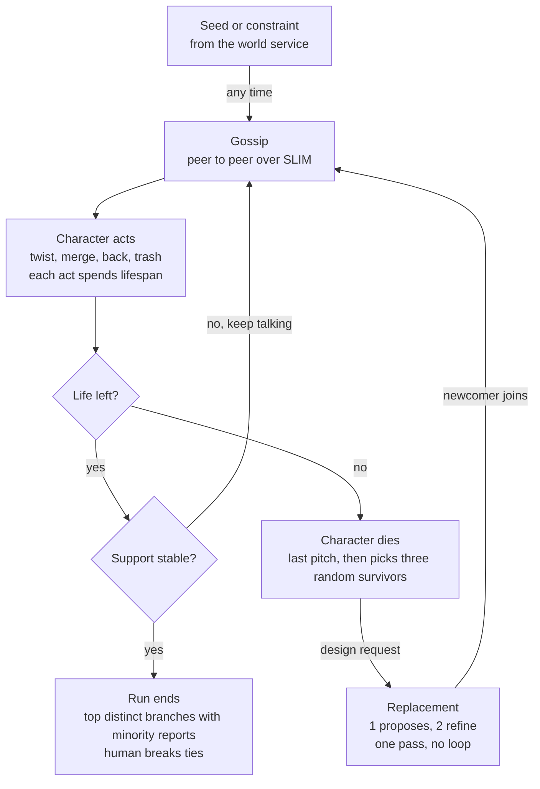
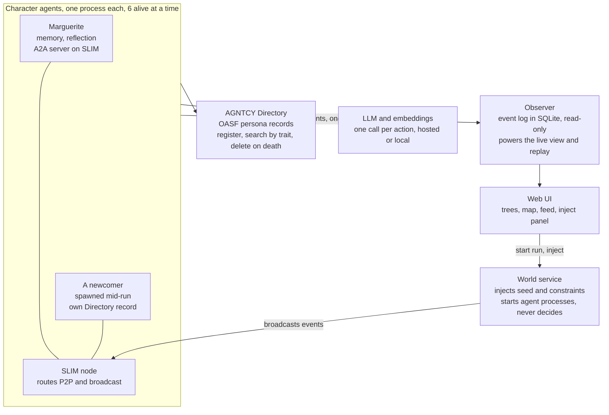

# Oddtown Plan and Architecture

Oct 10, 2026 · Oleg Mrynskyi

## Overview

Oddtown is a town of wonky AI characters who take a seed idea and fight over how to twist it, and who get replaced by brand new characters as they die off. We build it in 12 hours on AGNTCY for the When AI Agents Disagree track, aiming at Level 3 and picking up the Level 2 discovery and failure requirements along the way.

A user drops in a boring idea, like "a coffee subscription." It spreads peer to peer among six living characters, each with a strong worldview. Every character twists, merges, backs or trashes the versions it hears, so the idea grows into a family tree with rival factions.

Every character has a lifespan. When one dies, three random survivors design its replacement in one pass, with one proposing and two refining, and the newcomer gets published to the AGNTCY Directory. The town stays the same size, but nobody owns the idea forever.

The research question is simple. LLMs are known for samey ideas, so does a society of disagreeing characters produce ideas that are more original but still coherent than one model alone?

| Track requirement | How Oddtown meets it |
| --- | --- |
| Three or more autonomous agents with competing objectives | Six characters at a time, each with loves, hates and a red line that clash with the others |
| Genuine disagreement | Characters spend scarce endorsements on rival branches, and factions form around them |
| A real deliberation or negotiation mechanism | Merging two branches is a compromise, characters pitch for endorsements, and three survivors co-design every replacement |
| No central decision-maker | Peer-to-peer messaging over SLIM, each dying agent picks its own replacement team, and the world service only injects events |
| Effect of new information | Constraints injected mid-run kill some branches and reshape others |
| Comparison against a simpler baseline | One LLM alone, one LLM playing every character, and characters twisting with no interaction |
| When to stop, keep the disagreement, or ask a human | Explicit rules, covered in their own section below |
| Level 2 dynamic discovery | Characters look each other up by trait in the Directory, and new characters register at runtime |
| Level 2 unexpected failure | Characters die mid-conversation when their lifespan runs out, and the rest have to adapt |

The agent design starts from [Generative Agents](https://doi.org/10.1145/3586183.3606763) by Park et al., which gives each character a memory stream, reflection and planning. Oddtown adds scarce endorsements, lifespans and survivor-designed replacements on top. The name is a working title.

## How it works

A run is one loop that repeats until support stops moving. Characters gossip and act on ideas until their lifespans run out, and every death brings in a replacement designed by three random survivors.



The world service drops in the seed idea and can add constraints at any time. Ideas travel only by gossip, and each act a character takes spends part of its lifespan.

On every turn a character either twists a branch, merges two branches with another character's agreement, backs a branch with one of its two endorsements, trashes it, or pitches its own branch to someone. Endorsements are public, so everyone can see the factions even though they only hear the ideas secondhand.

When a character runs out of life, it picks three survivors at random. One drafts the newcomer and two refine it once each, then the newcomer joins the gossip. When support has stopped moving, the run ends with up to three distinct finalists, each with a minority report.

## Characters

Every character is a JSON persona with a strong worldview, six numeric trait axes and one red line. Wonkiness comes from values that are coherent and clash with each other, never from random jokes, because joke characters produce gimmicky twists.

```json
{
  "id": "char_7f3a",
  "name": "Marguerite Bell",
  "one_liner": "Retired lighthouse keeper who distrusts anything that needs electricity",
  "worldview": "Things worth having should outlast you. Most modern products are built to break.",
  "loves": ["objects that last fifty years", "manual work", "the sea"],
  "hates": ["subscriptions", "screens", "anything with a battery"],
  "red_line": "Never backs an idea that needs an app",
  "voice": "Short sentences, nautical metaphors, dry humor",
  "traits": {"time_horizon": 0.9, "tech_attitude": -0.8, "scale": -0.6, "sociality": -0.4, "risk": 0.2, "rationality": -0.3},
  "lineage": {"generation": 0, "designed_by": [], "replaces": null},
  "lifespan": {"max_actions": 40, "born_at": "2026-10-11T09:00:00Z"}
}
```

The trait axes make differences visible on the map view. Embeddings of the full persona text do the actual novelty scoring.

| Axis | -1 means | +1 means |
| --- | --- | --- |
| time\_horizon | Thinks in minutes | Thinks in centuries |
| tech\_attitude | Wants nothing with a plug | Wants everything automated |
| scale | One person, one street | The whole planet |
| sociality | Hermit | Needs a crowd |
| risk | Changes nothing without proof | Bets everything on a hunch |
| rationality | Runs on gut feelings, omens and vibes | Only trusts logic and evidence |

The run opens with six hand-written characters so the demo starts strong. They are spread across the trait space on purpose.

| Character | Worldview | Red line |
| --- | --- | --- |
| Marguerite, retired lighthouse keeper | Things should outlast you, and electricity is a trap | Never backs an idea that needs an app |
| Dez, competitive pigeon racer | Every problem is really a logistics problem | Trashes any idea with no delivery plan |
| Brother Anselm, a monk who thinks in decades | Anything worth doing takes ten years | Won't back anything built for speed |
| Priya, hyper-growth startup founder | If it can't reach a billion people it's a hobby | Won't back anything that can't scale |
| Tamsin, theater kid turned funeral director | Every product is secretly a ritual | Rejects ideas with no ceremony in them |
| Rook, deep-sea biologist | Everything should work like an ecosystem | Trashes anything that creates waste |

Every persona, hand-written or spawned, passes two checks before it goes live. A schema check confirms every field exists and traits sit between -1 and 1. A content check rejects real people, slurs, and caricatures built on race, religion or other protected traits.

## Lifespan and replacement

Every character has a lifespan, and every death brings in exactly one replacement designed by three random survivors in a single pass. One proposes the newcomer and two refine it, with no vote and no loop, so the population stays the same size while the town keeps changing.

### How lifespan works

Each agent counts its own lifespan in actions and wall-clock time, so there is no global clock. Starting lifespans are staggered between 50 and 100 percent of the max so deaths don't all land at once.

Agents see how much life they have left in every prompt. We expect near-death behavior to change, like pushing harder, compromising, or backing a rival, but we never script it. We only measure it.

Lifespan can be fixed or earned, and that is a setting. In popularity mode every endorsement an agent's branch receives adds actions. In novelty mode only endorsements on branches that are far from the other live branches count. Our hypothesis is that popularity mode drifts toward samey ideas.

When an agent dies it posts one last pitch of up to 280 characters and picks its replacement team. Then it removes its Directory record, closes its sessions and exits. Its branches stay on the tree, but a branch's support only counts living backers, so ideas have to keep winning fresh support.

### How a replacement gets designed

1. Pick. As its last act, the dying agent pulls the living roster from the Directory and picks three survivors at random. The first one proposes and the other two refine, in that order.
2. Propose. The proposer writes a full persona for someone as unlike the living town as possible, itself included. It sees a summary of every living persona.
3. First refine. The proposer sends the draft to the first refiner, who changes it once through its own worldview. It also sees which living character the draft sits closest to, and pushes it further away.
4. Second refine. The first refiner passes it on, and the second refiner makes one more change the same way.
5. Birth. The second refiner runs the schema and content checks, starts the new agent and publishes its record to the Directory. The newcomer introduces itself to the town.

Nobody votes and nothing loops, so a replacement costs three LLM calls plus the content check. The three designers usually want different things, so the newcomer ends up as a compromise none of them fully controlled.

If the dying agent crashes before it can pick, the first peer whose message to it bounces does the pick instead. If a designer dies mid-design, the next one in line skips that step. If the content check fails, the human sees the persona and either approves it or skips the replacement.

We measure novelty instead of enforcing it. Every newcomer's distance to its nearest living character gets logged, along with reinventions, which is when a newcomer lands close to someone who already died.

### Starting parameters

These are first guesses to tune in hour 6 with real runs.

| Parameter | Start value | Controls |
| --- | --- | --- |
| Population | 6 living, constant | Cost and readability |
| Lifespan | 40 actions or 8 minutes | Turnover speed |
| Starting lifespans | Staggered between 50 and 100 percent of max | Spreads deaths out |
| Design team | 3 random survivors, 1 proposes and 2 refine | Who shapes each newcomer |
| Active endorsements | 2 per agent | Scarcity of support |
| Earned life | 5 actions per qualifying endorsement | Earned-life modes |

## System architecture

Every character is its own process that reaches the others through a SLIM node, finds them through the AGNTCY Directory, and calls an LLM to decide. The world service, observer and UI sit outside the town, and none of them makes a decision.



The only arrow into the town from outside is the world service's broadcast, and the only arrow out is a one-way event stream to the observer.

| Component | Built with | Job |
| --- | --- | --- |
| Character agent | Python 3.12, `agntcy-app-sdk`, LangGraph or plain asyncio | Persona, memory, decision loop, lifespan counter, A2A server over SLIM |
| SLIM node | `ghcr.io/agntcy/slim` Docker image on port 46357 | Routes point-to-point and broadcast messages between agents |
| AGNTCY Directory | `dirctl daemon start` on localhost:8888, `agntcy-dir` Python SDK | Stores each persona as an OASF record with traits and lineage |
| World service | FastAPI | Broadcasts seeds and constraints, starts agent processes on request, stops the run at the token budget |
| Observer | FastAPI, SQLite, WebSocket | Append-only event log, live feed to the UI, replay of any run |
| Web UI | React, TypeScript, Vite, d3 | Idea tree, character family tree, persona map, message feed, inject panel, human request cards |
| Experiment runner | Python script | Runs baselines and conditions headless and writes a metrics CSV |
| LLM and embeddings | Still open | One decision call per action, embeddings for retrieval and novelty |

### How we use AGNTCY

Messaging. Each agent serves an A2A agent card over SLIM through the app-sdk, using `factory.create_app_session(...)` and `add_a2a_card(...)`. Point-to-point messages use `client.send_message`, and town-wide messages use `client.broadcast_message` with the living agents from the Directory as recipients. We skip SLIM group sessions because they need a moderator to invite and remove members, and the town has no owner.

Discovery. Every persona is pushed to the Directory as an OASF record and published, with its traits and parents stored as annotations. Directory search can't filter numeric ranges, so agents pull the living records and rank them by trait locally.

Lifecycle. Birth means push and publish, and death means unpublish and delete. A crashed agent can leave a stale record, so a bounced message counts as a death and peers stop routing to that agent.

Observability. `AgntcyFactory(enable_tracing=True)` sends Observe SDK traces to an OTLP endpoint, which we can show in Grafana if time allows. Our own observer drives the UI either way.

Identity is a stretch goal. AGNTCY Identity badges would let agents sign ballots, so only living, registered characters can vote.

### Repo layout

```text
oddtown/
  agents/        character.py, brain.py, memory.py, replace.py, prompts/
  transport/     adapter.py, slim_a2a.py, http_fallback.py
  registry/      adapter.py, agntcy_dir.py, memory_registry.py
  world/         service.py, launcher.py
  observer/      app.py, store.py
  ui/            React app
  experiments/   baselines.py, run_conditions.py, metrics.py
  personas/      starting_cast.json
  docker-compose.yml   slim, directory, observer, world
```

The transport and registry adapters are what make the fallbacks in the risk table cheap. Agents only ever call `send`, `broadcast`, `register`, `search` and `remove`.

## Message protocol

All traffic is JSON inside A2A messages, sent either point to point or as a broadcast to every living agent. Idea content only travels by gossip, while endorsements, births and deaths are public so everyone can see the factions.

```json
{
  "type": "idea.share",
  "msg_id": "0b6c2e1a-4f1d-4c8e-9a51-2f7d3c9e8b10",
  "from": "char_7f3a",
  "to": "char_19bc",
  "sent_at": "2026-10-11T09:14:03Z",
  "body": {
    "branch": {
      "branch_id": "br_042",
      "parent_ids": ["br_017"],
      "op": "twist",
      "author": "char_7f3a",
      "text": "Coffee beans delivered once a year in a hand-built oak chest that outlives you",
      "created_at": "2026-10-11T09:13:58Z"
    },
    "note": "Your monthly drip is a leash. Here is something worth waiting for."
  }
}
```

| Type | Sent | When | Reply |
| --- | --- | --- | --- |
| `idea.share` | Point to point | A character passes a branch to a peer | `idea.reaction` with the action taken and a one-line reason |
| `idea.pitch` | Point to point | A character tries to win a peer over to its branch | `pitch.response` saying persuaded or not, and why |
| `merge.propose` | Point to point | A character offers to combine its branch with the peer's | `merge.response` accepting, rejecting, or countering with new text |
| `endorse` / `unendorse` | Broadcast | A character backs or drops a branch, max two active | None |
| `replace.request` | Point to point | A dying agent tells each of its three picks their role and the order | None |
| `persona.draft` | Point to point | The proposer hands the draft to the first refiner, who hands it to the second | None |
| `agent.hello` | Broadcast | A newcomer introduces itself with its Directory record id | None |
| `agent.last_words` | Broadcast | An agent's lifespan runs out | None |
| `world.event` | Broadcast from the world service | A seed idea, a new constraint or simulated customer feedback | None |
| `rest` | Broadcast | An agent believes the town is stable | None |

A merge only becomes a branch when both sides accept, and the result lists both as authors. Every message is also posted to the observer as an event so the UI can draw it, but agents never read from the observer.

## Agent brain

Each character runs a trimmed version of the Generative Agents loop, with one LLM call per action so cost stays predictable. Memory, reflection and an agenda shape what it does, but the persona's loves, hates and red line always come first in the prompt.

### Memory stream

Every observation lands in a per-agent list with its text, timestamp, kind, importance from 1 to 10 and an embedding. Kinds include heard idea, reaction, endorsement seen, world event, replacement, death and reflection.

Each character rates importance itself, from 1 to 10, through its own worldview. A constraint like "it has to work with no electricity" might be a 10 for Marguerite and a 3 for Priya, so the same event shapes each character's memory differently.

Rating costs no extra calls. The decision call returns scores for every observation that arrived since the agent's last call, and a memory counts as 5 until it gets scored.

### Retrieval

Retrieval uses the paper's score with equal weights. Each term is normalized to 0 to 1, recency decays by 0.99 per action, and we keep the top 8 memories.

```latex
\text{score}(m) = \text{recency}(m) + \text{importance}(m) + \text{relevance}(m, q)
```

### Reflection

When the importance of memories since the last reflection adds up past 40, the agent writes two or three insights about the ideas and the other characters. An example is "Dez reduces everything to delivery, so his versions rarely surprise me." Insights go back into memory with importance 8, and they steer who the agent talks to next.

### Agenda

After each reflection the agent rewrites a short agenda. It names the branch it champions and who it wants to win over.

### The decision call

An agent acts when a message arrives or when an idle timer fires after 5 to 15 random seconds. It retrieves memories, then makes one structured call that returns JSON.

```json
{
  "action": "twist",
  "target_branch": "br_042",
  "text": "An oak chest of beans that you refill by rowing to a lighthouse once a year",
  "send_to": "char_19bc",
  "endorse": ["br_051"],
  "unendorse": [],
  "importance": {"obs_118": 9, "obs_119": 2},
  "reason": "Rook's ecosystem angle needs a ritual, and I can give it one"
}
```

The allowed actions are twist, merge, back, trash, pitch and ignore. The agent picks peers from the Directory, weighted by what its memories say about them plus some randomness, so it doesn't get stuck talking to one friend.

### Call budget

These are rough estimates for a 15 minute demo run with 6 living agents, each acting about every 10 seconds.

| Call type | Approx. calls per run |
| --- | --- |
| Decisions, including importance scores | 540 |
| Reflections | 80 |
| Replacements, 3 design calls and 1 content check each | 50 |
| Total | About 670 |

At roughly 2,000 input tokens and 250 output tokens per call, that is about 1.5 million tokens per demo run. Experiment runs last 5 minutes to stay around a third of that.

## When to stop, keep the disagreement, or ask a human

In creative work early consensus is the failure, so Oddtown never forces one answer. The run ends with up to three distinct finalists plus the objections against each, and a human is pulled in only for ties and rule breaks.

### Stopping

Each agent watches support on its own. When no branch has gained or lost a living backer for two minutes and no replacement is being designed, the agent broadcasts `rest`. Once a majority of living agents have posted `rest`, everyone stops. A 15 minute time budget also ends the run.

### Keeping the disagreement

The output is the top branches by living support that are at least a distinctness threshold apart, starting at a cosine distance of 0.35, up to three. Each finalist comes with its champions and their reasons, plus the strongest objection from a rival faction as a minority report. Two finalists closer than that threshold are really the same idea, so only those get merged.

Disagreement about taste is kept and reported, because that is the useful part. Disagreement about feasibility, like whether something can be built for under $50, is a factual question, so it goes to the human instead of being argued forever.

### Asking a human

| Situation | What the human sees | What they decide |
| --- | --- | --- |
| Two distinct finalists tie on support at the time budget | Both branches with their champions and objections | Pick one or keep both |
| A branch breaks a hard rule set with the seed, like legality, physics or budget | The branch and the rule it breaks, flagged by any agent | Allow it, or kill the branch |
| A feasibility dispute between factions | The claim and both sides' reasoning | Which side is right |
| A replacement persona fails the content check | The persona and what the check flagged | Approve it or skip the replacement |

Requests go to the observer as a `human.request` event and show up in the UI as a card. The run keeps going while it waits, and the branch in question is frozen until the human answers.

## Experiments and evidence

The headline experiment asks whether the full town keeps idea diversity from collapsing better than a single model, at similar coherence. Everything runs headless from the same code, and every run writes a JSONL event log we can replay and score.

### Hypotheses

1. The full town produces a more diverse and more original set of ideas than one LLM, without losing coherence.
2. Survivor-designed replacements keep diversity up over time compared to random replacements or characters that never die.
3. Stretch goal. Popularity-earned lifespan drifts toward samey ideas compared to novelty-earned lifespan.

### Conditions

| Condition | What runs | What it tests |
| --- | --- | --- |
| B1 Single LLM | One model asked for 10 radical twists of the seed | The simplest baseline |
| B2 One LLM, every character | One prompt holding all six personas, producing twists in turn | Whether separate agents matter at all |
| B3 Independent characters | Each character twists the seed alone with no messaging | Whether interaction matters |
| Full town | Gossip, scarce endorsements, lifespans, survivor-designed replacements | Our system |
| A1 No memory or reflection | Full town with the paper's ablation | Whether the agent brain matters |
| A2 Random replacements | Full town, but newcomers are random personas | Whether survivor design matters |
| A3 Immortal town | Full town with no lifespans, so nobody is ever replaced | Whether death and turnover matter |

Every condition outputs 10 ideas for scoring. For the town that means the 10 most-supported branches that clear the distinctness threshold from each other.

### Metrics

| Metric | How we compute it |
| --- | --- |
| Diversity | Mean pairwise cosine distance between the 10 ideas, plus how many stay distinct after merging pairs closer than the threshold |
| Distance from seed | Mean cosine distance between each idea and the seed |
| Coherence | Blind human rating from 1 to 5 on whether the idea makes sense and could exist, with an LLM judge on a fixed rubric as backup |
| Originality | Blind human rating from 1 to 5 on how surprising the idea is |
| Diversity over time | Mean distance between live branches every 30 seconds, drawn as one line per condition |
| Behavior | Support shifts after an injected constraint, merge rate in the last fifth of an agent's life against earlier, and reinvention count |

### Run protocol

We run 3 seed ideas with 3 random seeds per condition, using the same model, temperature and embedding model throughout. For human ratings we ask 10 to 15 people at the event to rate a shuffled, unlabeled form of ideas from each condition.

The sample is small, so we report means with their spread and say so on the slide. The diversity-over-time chart is the main exhibit in the pitch.

## Demo script

The demo runs about four minutes and follows one seed idea from a samey baseline to three finalists. Each beat is something judges can see happen on screen, not something we just claim.

| Time | On screen | What we say |
| --- | --- | --- |
| 0 to 30 s | Ten "radical" twists of "a coffee subscription" from one LLM, all clustered on the map | One model alone gives you ten versions of the same idea |
| 30 s to 1 min | Oddtown starts with the same seed, or a judge's idea, and six characters light up | These characters only talk to each other, and nobody runs the town |
| 1 to 1.5 min | Two factions form on the idea tree, and a merge negotiation plays out in the feed | Click a character to see its memories and why it changed its mind |
| 1.5 to 2 min | A character's lifespan runs out, it posts its last pitch and picks three survivors, one drafts a replacement, two refine it, and the newcomer lands on the map | Death is how new perspectives get into the town |
| 2 to 2.5 min | We inject "it has to work with no electricity" and branches die or reshape | Marguerite's branch suddenly gets backers |
| 2.5 to 3 min | We kill an agent's process by hand, a message to it bounces, and the peer who noticed picks the replacement team | Even a crash gets handled with nobody in charge |
| 3 to 3.5 min | The run ends with three finalists, minority reports and one human decision card | We kept the disagreement on purpose, and asked a human only for the tie |
| 3.5 to 4 min | Diversity over time for every condition, plus the human ratings | Here is the evidence, and here is what surprised us |

The UI can replay any run from its event log. We record a full run with a locked seed by hour 10 and keep it ready in case the live run stalls or the network dies.

## 12-hour build plan

The build runs four lanes in parallel, one per person, and every lane meets at the same gates. The core loop of gossip, lifespans and replacements has to work by hour 6, so the last four hours go to tuning, evidence and rehearsal instead of new features.

| Lane | Task | Hours from kickoff |
| --- | --- | --- |
| Platform and AGNTCY | SLIM, app-sdk, Directory up | 0 to 1.5 |
| Platform and AGNTCY | Transport and registry adapters | 1.5 to 3 |
| Platform and AGNTCY | World service and launcher | 3 to 4.5 |
| Platform and AGNTCY | Observer, event log, replay | 4.5 to 6.5 |
| Platform and AGNTCY | Fallback switches, hardening | 6.5 to 10 |
| Agent brain | Persona schema, starting cast | 0 to 1.5 |
| Agent brain | Memory, retrieval, decision call | 1.5 to 4 |
| Agent brain | Lifespan and replacements | 4 to 6 |
| Agent brain | Reflection, prompt tuning | 6 to 8.5 |
| UI | Scaffold on mock events | 0 to 2 |
| UI | Idea tree and message feed | 2 to 5 |
| UI | Persona map, family tree | 5 to 7.5 |
| UI | Inject panel, human cards, polish | 7.5 to 10 |
| Evidence and pitch | Baseline scripts B1 to B3 | 0 to 3 |
| Evidence and pitch | Metrics and condition runner | 3 to 6 |
| Evidence and pitch | Condition runs and charts | 6 to 9 |
| Evidence and pitch | Human ratings form | 8 to 10 |
| Evidence and pitch | Slides, recorded demo, submit | 10 to 12 |

Gates fall at hour 1.5 (two agents talk), hour 4 (town gossips), hour 6 (replacement works), hour 8 (UI on live runs), hour 10 (feature freeze) and hour 12 (submit).

The UI lane builds against mock events from hour 0, so it never waits on the agents. If we only have three people, the brain and UI owners split the evidence lane after hour 6.

### Gate checks

- [ ] Hour 1.5. Two agents exchange an A2A message over SLIM, and one persona record is searchable in the Directory.
- [ ] Hour 4. Six characters gossip a seed end to end, and their branches show up in the observer log.
- [ ] Hour 6. An agent dies cleanly, three survivors design its replacement, and the newcomer joins the gossip.
- [ ] Hour 8. The UI draws a live run with the idea tree, persona map and message feed.
- [ ] Hour 10. Feature freeze, baseline numbers in, and a full demo run recorded with a locked seed.
- [ ] Hour 12. Demo, architecture overview, implementation details and results submitted.

Missing a gate by more than 30 minutes triggers the fallback for that lane from the risk table.

## Risks and fallbacks

The biggest risk is AGNTCY setup eating the first hours, so all transport and registry code sits behind two small adapters we can swap. If we fall behind, we cut features in a fixed order instead of rushing everything.

| Risk | Early signal | Fallback |
| --- | --- | --- |
| SLIM or the app-sdk fights us | Two agents can't exchange a message by hour 1.5 | Switch the app-sdk transport to NATS like Lungo's default, and if that fails, use plain A2A over HTTP |
| Directory integration stalls | Push and search don't work by hour 3 | A small in-memory registry with the same push, search and delete interface |
| LLM latency or rate limits | Agents average slower than one action per 10 seconds | Cap concurrency, use a smaller model for decisions, shorten runs |
| Replacements all look alike | Newcomers' novelty scores stay low | Raise the proposer's temperature, show it past newcomers, seed it with a random job, era and obsession from word lists |
| A replacement persona is offensive | Content check fires | The human approves or skips it |
| Deaths bunch up | Several characters die within the same minute | Stagger starting lifespans more widely |
| Agents drift off the idea | Branches stop mentioning the seed | Seed and constraints go in every prompt |
| Cost blows up | Token counter passes the per-run budget | The world service stops the run, and the fixed population and lifespans bound it anyway |
| Live demo misbehaves | Anything odd during rehearsal | Replay the recorded run from its event log |

If we run out of time, we cut in this order.

1. AGNTCY Identity badges on ballots
2. Earned-lifespan modes, keeping fixed lifespan only
3. A2 random-replacement ablation
4. Polish on the persona map
5. A1 memory ablation

We never cut gossip, branches, lifespans, replacements, the B1 baseline or replay.

## Open questions

- [ ] How many people are on the team, and who owns each lane in the build plan?
- [ ] Which LLM and embedding model, and do we run them hosted or locally on the event hardware?
- [ ] LangGraph to match coffeeAGNTCY, or plain asyncio because it's faster for us to write?
- [ ] Do we let a judge pick the seed idea live, or stick to a rehearsed seed?
- [ ] Can we get 10 to 15 people at the event to blind-rate ideas?
- [ ] Final name, if not Oddtown

## Sources

- [Generative Agents, Park et al. 2023](https://doi.org/10.1145/3586183.3606763)
- [coffeeAGNTCY reference app](https://github.com/agntcy/coffeeAgntcy)
- [AGNTCY app-sdk](https://github.com/agntcy/app-sdk)
- [SLIM sessions](https://slim.agntcy.org/latest/slim/slim-session/)
- [SLIM repository](https://github.com/agntcy/slim)
- [Directory Python SDK](https://dir.agntcy.org/latest/dir/dir-sdk-python/)
- [Directory CLI reference](https://dir.agntcy.org/latest/dir/dir-cli-reference/)
- [Directory repository](https://github.com/agntcy/dir)
