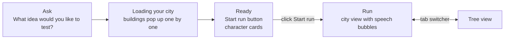

# Oddtown UI Plan

Oct 11, 2026 · Oleg

The UI is one page that takes a person from typing an idea, to watching their town get built, to watching the characters argue about the idea. It has two views, the city and the idea tree. A floating tab switcher, centered at the top of the screen, moves between them.

## Flow

## Screens

### 1. Ask

The page opens on a single chat-style input, and nothing else is on screen. The prompt reads "What idea would you like to test?" Submitting it sends the idea to the world service as the seed and moves to loading.

### 2. Loading your city

"Loading your city" text sits over an empty isometric city. The buildings pop up one at a time, each with a burst of dust particles as it lands.

Each building should pop up when that character's agent actually comes online, so the loading screen shows real progress instead of a fixed animation.

### 3. Ready

Once all six buildings are up, a "Start run" button appears. Below it is a list of cards, one per character, showing who they are and their traits.

Clicking "Start run" starts the run.

### 4. Run, city view

The characters start talking. When a character says something, a speech bubble pops up above its house.

### 5. Tree view

The idea tree is its own view, reached from the tab switcher. It shows how the idea branches as the characters twist, merge and back versions of it.

## Tab switcher

A small floating pill, centered at the top of the screen, with two tabs, City and Tree. It is only shown once the run has started.

## What this needs from the others

| From | What | Why |
| --- | --- | --- |
| Clara, world service | Separate steps for preparing the town and starting the run, so agents can come online before anyone clicks "Start run" | The loading and ready screens sit between those two steps |
| Clara, world service | An event as each agent comes online, with its persona | Each building pops up on its own event, and the cards need the traits |
| Anthony, agents | A short line of text on every act a character takes | That line is what goes in the speech bubble |

## Not decided yet

These were in the earlier plans but aren't part of this design yet.

- What the city shows when a character dies and its replacement arrives.
- Whether clicking a house opens anything.
- Faction flags on houses, and a billboard for world events.
- The inject panel for new constraints, and the human request cards.
- The end screen with the three finalists next to the single LLM's three ideas.
